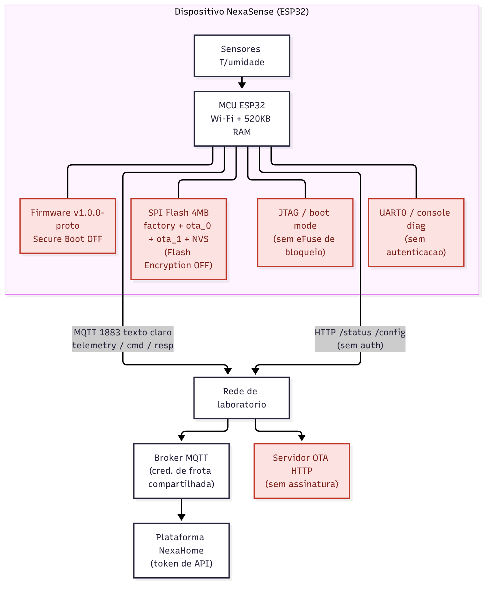

# NexaHome IoT Security — Avaliação de segurança do protótipo NexaSense

Avaliação de segurança (IoT Security Analyst) do dispositivo **NexaSense** da
NexaHome Technologies — sensor ambiental baseado em **ESP32** que coleta
temperatura/umidade e as transmite a uma plataforma de monitoramento.

> **Escopo / autorização.** Todo o trabalho foi feito **exclusivamente em ambiente
> de laboratório simulado** (QEMU/Espressif e simulador online Wokwi), sobre o
> **firmware educacional** do próprio dispositivo. **Nenhum** teste foi executado
> contra dispositivos de terceiros, serviços externos, redes de produção ou
> equipamentos conectados à Internet. Todos os valores sensíveis
> (senhas/tokens/SSID) são **fictícios** e locais. eFuses irreversíveis **não**
> foram gravados — medidas de hardware são propostas conceitualmente.

## Objetivo da avaliação
Mapear a **superfície de ataque** do protótipo (hardware + firmware + comunicação +
acesso físico), identificar riscos **relevantes com evidência técnica**,
classificá-los por impacto × probabilidade e propor **mitigações** e um **plano de
hardening** para a futura versão comercial.

## Dispositivo analisado
- MCU **ESP32** (Wi-Fi), firmware `NexaSense v1.0.0-proto` (ESP-IDF v5.3.2).
- Sensores de temperatura/umidade; publicação de telemetria via **MQTT**; servidor
  **HTTP** local; **console de diagnóstico** na UART0; **OTA** por HTTP.
- Partições: `factory + ota_0 + ota_1 + NVS` (flash 4 MB).

## Arquitetura


Fluxo: `Sensores → ESP32 (Firmware/Flash/UART/JTAG) → MQTT/HTTP → Rede de laboratório → Broker/OTA → Plataforma`.
Em vermelho, os pontos sem proteção adequada. Fonte editável: `architecture/architecture.mmd`.

## Superfície de ataque (resumo)
| Camada | Pontos | Achados |
|---|---|---|
| Hardware / acesso físico | UART0 (console), boot/download mode, SPI Flash, JTAG | F01, F07 |
| Firmware | segredos embutidos, imagem sem assinatura, Secure Boot/Flash Enc OFF | F02, F05, F07 |
| Comunicação | MQTT texto claro + credencial de frota; HTTP `/config` sem auth; comando sem autorização | F03, F04, F06 |
| Lógica/estado | factory reset / reconfiguração sem auth | F08 |

## Ferramentas utilizadas
- **QEMU** (fork Espressif, `qemu-system-xtensa`) — emulação do ESP32 e captura de tráfego (`filter-dump` → pcap).
- **ESP-IDF v5.3.2** (`esptool.py image_info`, `gen_esp32part.py`) — build e análise da imagem.
- **mosquitto / mosquitto_sub/pub** — broker e cliente MQTT do laboratório.
- **tshark / Wireshark** — análise dos pcaps.
- `strings`, `sha256sum` — análise estática e preservação de evidência.
- **Wokwi** (opcional) — simulação online no navegador (`wokwi/`).

## Organização das evidências
```
architecture/   diagrama (mmd + png)
firmware/       hashes.txt, analysis-notes.md, original/ (ro), work/, evidence/
hardware/       interface-map.md, evidence/ (uart-01-boot-e-console.log)
network/        protocol-analysis.md, evidence/ (*.pcap, http_*, mqtt_*)
demo/           evidence/ (demoA-* injeção MQTT, demoB-* OTA sem assinatura)
findings/       findings.md (tabela de risco), exemplo-real-pesquisado.md
remediation/    hardening-plan.md
src/            código do firmware educacional (secrets.example.h — sem segredos reais)
lab/            scripts reproduzíveis (env.sh, run_qemu.sh, uart_client.py, mosquitto/)
wokwi/          projeto para o simulador online
```

## Resumo da análise de firmware
Imagem preservada (SHA-256 em `firmware/hashes.txt`) e analisada em cópia de
trabalho. Formato ESP32 válido, 5 segmentos, checksum válido (**integridade, não
autenticidade**). `strings` revelou **todos** os segredos em texto claro (Wi-Fi,
senha MQTT de frota, token de API, OTA URL). Detalhes: `firmware/analysis-notes.md`.

## Resumo da análise de hardware
UART0 com console de diagnóstico **sem autenticação** (boot log + comandos
`config/ota/factory`); boot/download mode e JTAG sem bloqueio por eFuse; flash sem
criptografia. `hardware/interface-map.md`.

## Resumo da análise dos protocolos
MQTT na porta 1883 **sem TLS**: CONNECT expõe usuário/senha e cada telemetria
carrega o token. HTTP local `/config` devolve a configuração completa sem auth.
`network/protocol-analysis.md`.

## Principais achados
F05 (OTA sem assinatura, **crítico**), F01/F02/F03/F04/F07 (**alto**). Tabela
completa com evidência/impacto/probabilidade/risco/mitigação em
`findings/findings.md`.

## Recomendações (topo do plano de hardening)
1. Assinatura de firmware + **Secure Boot v2**; OTA assinado sobre HTTPS com rollback.
2. **mTLS** no MQTT + **credencial única por dispositivo** (fim da senha de frota).
3. **Flash Encryption**; segredos fora da imagem; desativar console/`/config` em produção.

Plano completo: `remediation/hardening-plan.md`.

## Como reproduzir (ambiente autorizado)
Pré-requisitos: Linux, QEMU-Espressif e ESP-IDF v5.3.2 (ver `lab/env.sh`).
```bash
cd nexahome-iot-security
./lab/reproduce.sh          # compila (se necessário), inicia broker, roda as 3 capturas e as demos A e B
```
Cada etapa está detalhada em `lab/reproduce.sh`. Para o navegador, ver `wokwi/README.md`.

## Vídeo de demonstração
Link (YouTube não listado / plataforma equivalente): **https://youtu.be/TIdxt-G-tp4**

---
*Credenciais, tokens e senhas deste repositório são fictícios e de laboratório; não
há dados sensíveis reais. Avaliação para fins educacionais (UniFECAF — IoT Security).*
